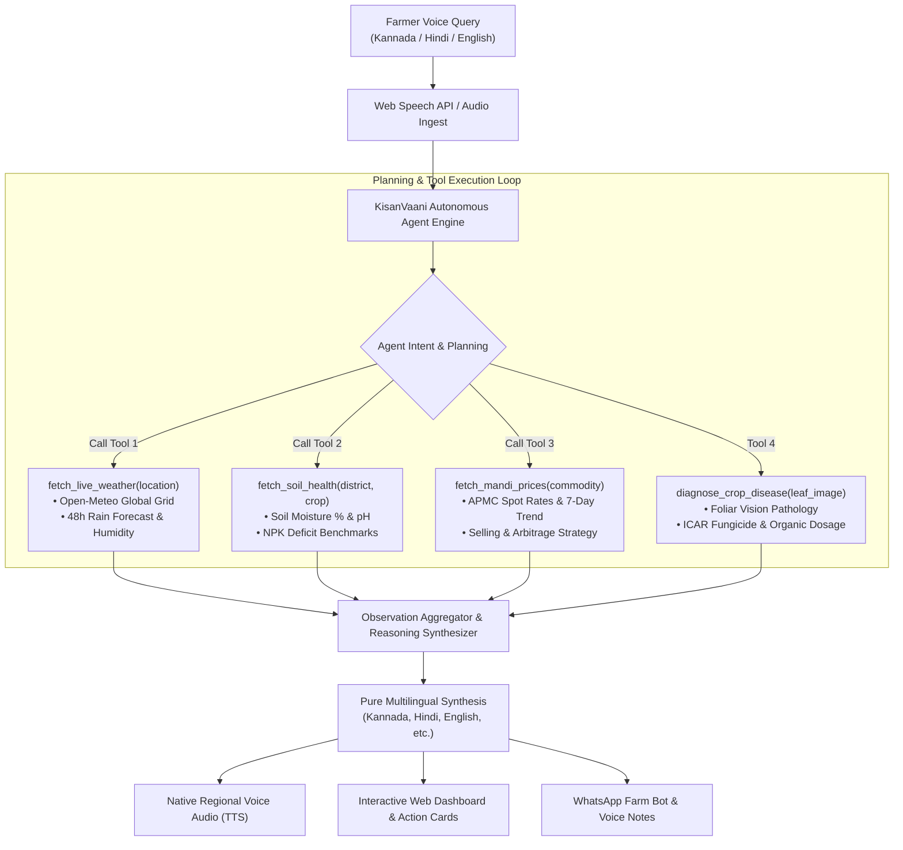

# 🌾 KisanVaani (ಕಿಸಾನ್ ವಾಣಿ • किसान वाणी)
### Autonomous Voice-First Farm Advisor with Real-Time Tool Calling, Mandi Intelligence, WhatsApp Delivery & Leaf Vision Diagnostics

[](https://github.com)
[](https://github.com)
[](https://python.org)
[](LICENSE)

---

## 📌 Executive Summary

**KisanVaani** is a multimodal, multilingual **AI Farm Advisor** designed to bridge the agricultural digital divide for smallholder farmers. By speaking directly to the AI advisor in their native tongue (**Kannada, Hindi, Tamil, Telugu, Marathi, or English**), farmers receive actionable agronomic directives through **voice** and **WhatsApp**.

Unlike traditional passive chatbots, KisanVaani operates as an **Autonomous Tool-Calling Agent**:
1. Analyzes conversational voice queries to decompose intent.
2. Autonomously calls domain-specific tools:
   * **Live Weather Tool**: Real-time precipitation forecast and evapotranspiration risk (Open-Meteo API).
   * **Soil Health Card Tool**: Soil moisture %, soil pH, NPK nutrient deficits, and organic amendments (ICAR benchmarks).
   * **APMC Mandi Intelligence Tool**: Real-time commodity spot prices, 7-day price trends, and spatial mandi arbitrage.
3. Formulates holistic recommendations for **Irrigation Directives** (e.g., skip watering when rain > 5mm is predicted) and **Strategic Selling** (hold vs liquidate).
4. Integrates a **Multimodal Leaf Vision Doctor** for immediate plant disease detection and pesticide dosage calculation from a phone snapshot.

---

## 🏗️ System Architecture & Tool-Calling Loop



---

## ✨ Core Features

* **Voice-First in Local Languages**: Web Speech recognition and vocal text-to-speech in **Kannada (kn-IN)**, **Hindi (hi-IN)**, **Tamil (ta-IN)**, **Telugu (te-IN)**, **Marathi (mr-IN)**, and **English (en-IN)**.
* **Tool Calling - Live Weather**: Real-time weather, 48-hour rain prediction, and humidity from Open-Meteo's agricultural meteorological grid.
* **Tool Calling - Soil Health Data**: Tracks soil moisture %, pH status, NPK levels, and recommends specific fertilizer amendments (Urea, SSP, MOP).
* **Tool Calling - APMC Market Prices**: Live commodity prices across major mandis (Kolar, Shimoga, Bangalore, Nashik) with 7-day price momentum analysis.
* **Integrated Irrigation & Selling Directives**: Cross-correlates precipitation probability with soil moisture to prevent water waste and avoid chemical runoff.
* **WhatsApp Farm Advisor**: Full WhatsApp simulator with voice notes, audio bubbles, regional text, and camera photo sharing.
* **Leaf Disease Detection**: Multimodal computer vision diagnostic tool identifying crop diseases (Rust, Early/Late Blight) with confidence scores and chemical/organic remedies.

---

## 🚀 How to Run Locally

### 1. Prerequisites
Ensure you have **Python 3.10+** installed on your system.

### 2. Install Dependencies
```bash
pip install -r requirements.txt
```

### 3. Run Verification Tests
Verify all tool modules and APIs are functioning:
```bash
python test_app.py
```

### 4. Launch KisanVaani
```bash
python app.py
```
Open your browser at:
```
http://127.0.0.1:5000
```
*(Or double-click `run_app.bat` on Windows).*

---

## 📂 Project Directory Structure

```
kisanvaani/
├── app.py                      # Main Flask application & REST endpoints
├── requirements.txt            # Minimal, lightweight dependencies
├── README.md                   # Complete project documentation
├── test_app.py                 # Automated test verification suite
├── run_app.bat                 # 1-Click Windows execution script
├── agent/
│   └── advisor_agent.py        # FarmAdvisorAgent core (Planning, Tool Calling, Pure Multilingual Synthesis)
├── tools/
│   ├── weather_tool.py         # Open-Meteo live weather & rain forecast tool
│   ├── soil_tool.py            # Soil Health Card & moisture threshold tool
│   ├── mandi_tool.py           # APMC spot rates & selling intelligence tool
│   └── crop_disease_tool.py    # Foliar leaf disease computer vision tool
├── templates/
│   └── index.html              # Modern, responsive Web UI with Tailwind CSS
└── static/
    ├── css/
    │   └── style.css           # Styling, pulse animations, audio wave, WhatsApp bubbles
    ├── js/
    │   └── app.js              # Voice recognition, TTS, trace visualizer, WhatsApp logic
    ├── sample_leaves/          # Sample images for testing foliar disease diagnosis
    └── uploads/                # Directory for user-uploaded leaf photos
```
