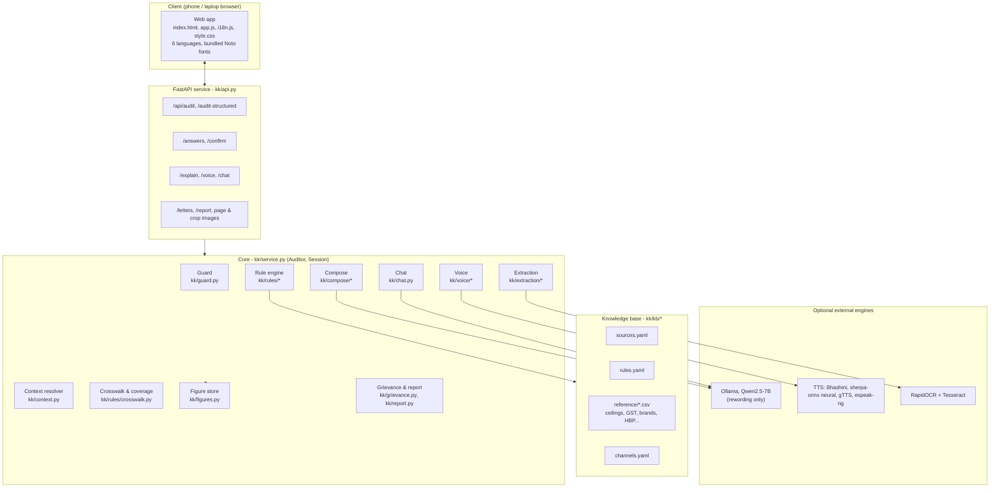
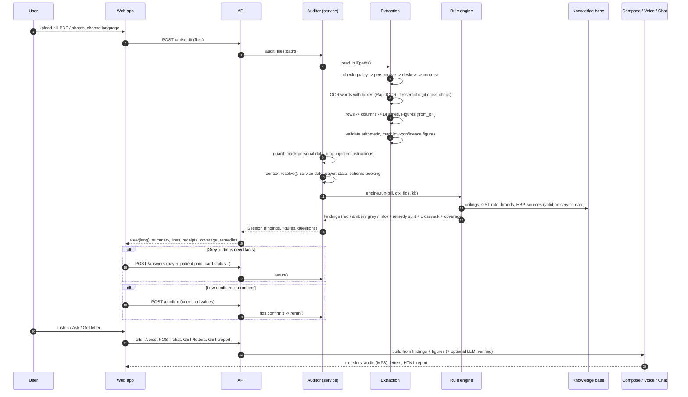
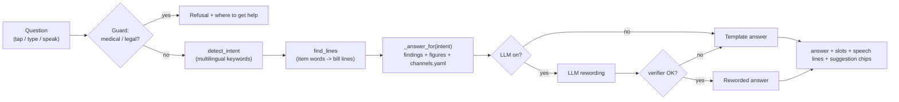
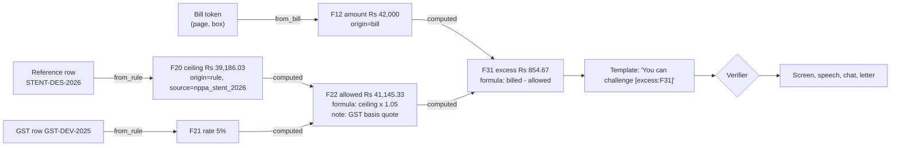

# Kharcha Kavach v2: Architecture, Workflow and Modules

Kharcha Kavach reads an Indian hospital bill (PDF or phone photos) and checks its lines against official rules:

- NPPA price ceilings
- MRP
- PM-JAY entitlement
- arithmetic
- billing conventions

It then shows the family, in their language, what may be wrong, how much they can challenge, and where to complain. Every number it shows can be traced back to the bill or to a dated official source.

> **Core principle: the LLM reads and explains; rules decide; data proves.**
> No amount is ever produced by a language model. Every number on screen, in speech, in chat or in a letter comes from the **figure store**, and any AI-written text is checked by the **slot verifier** before anyone sees it.

---

## 1. Design principles

| Principle | How it is enforced |
|---|---|
| No invented numbers | Every number is a `Figure` with a role, origin and evidence. Text refers to figures through slots like `[excess:F31]`. The verifier rejects digits in any script, number words and currency symbols outside slots. |
| Rules decide, not the model | The 15 rules are plain Python functions registered in `data/rules.yaml`. The LLM is optional and can only reword. |
| Honest verdicts | **Red** means a binding rule is broken and proven. **Amber** is worth asking about, never an accusation. **Grey** means a fact is missing, so the app asks the user. **Info** is a rule on hold. |
| Every source is dated | `data/sources.yaml` holds URL, notification number, validity dates and quoted wording (for example the GST basis of a ceiling). Each reference row points to its source. |
| Coverage is shown, not claimed | Every bill line gets a crosswalk status (*rule*, *pending*, *basic*) with a reason. The coverage share is shown as a figure. |
| Remedy is split honestly | Hospital-side overcharges (price, MRP, arithmetic) are kept separate from scheme grievances, which the State Health Agency decides. |
| Privacy | Personal data (Aadhaar, with a Verhoeff check; phone numbers; names in labelled fields) is masked. Sessions expire, and a session can be deleted through the API. |

---

## 2. High-level architecture



### Layers

1. **Input layer**: upload (PDF and photos) or structured JSON; guard; image preparation; OCR.
2. **Understanding layer**: table reconstruction, bill model, arithmetic validation, context (payer, dates, state, scheme booking).
3. **Decision layer**: rule registry, line classification (stent, knee, scheduled medicine), engine aggregation, crosswalk.
4. **Proof layer**: figure store, sources, evidence (page, bounding box, table row, formula).
5. **Communication layer**: templates in six languages, optional LLM rewording behind the verifier, voice, chat, letters, printable report.

---

## 3. End-to-end workflow



### Steps in words

1. **Upload.** The user sends a PDF and/or photos in page order, or a structured JSON bill (used for typed bills and tests).
2. **Prepare images.** `preprocess.py` checks blur, darkness and size, corrects perspective, deskews and boosts contrast. Bad photos are reported back rather than guessed at.
3. **Read words.** `ocr.py` gets words with positions from the PDF text layer when there is one, or from RapidOCR/Tesseract. Digits are cross-checked between the two engines.
4. **Rebuild the table.** `table.py` groups words into rows, finds the columns (description, qty, rate, amount, GST, MRP) and sections. `parse.py` builds a `Bill` (header plus `BillLine`s). Every number becomes a `Figure` with `Origin.BILL` and its page and box as evidence.
5. **Validate.** `validate.py` checks qty x rate = amount and the line sum against the total. Uncertain figures are marked `needs_confirmation`; the UI shows a crop of the bill and asks the user to confirm.
6. **Guard.** `guard.py` masks personal data, removes text that looks like instructions to an AI, decides refusals (medical or legal advice) and detects the language of typed questions.
7. **Resolve context.** `context.py` settles the facts that decide which rules apply: the date of service (discharge date, else admission date, else the user's answer), the payer (cash, PM-JAY or state scheme, insurance), whether the case was booked under the scheme, and the state. Unknown facts produce grey "please tell us" questions instead of guesses.
8. **Run rules.** `engine.py` runs every rule in `rules.yaml` whose status allows it. A line flagged by several rules is counted once, and amounts are split into hospital, scheme and fallback buckets.
9. **Crosswalk.** `crosswalk.py` records, for every line, which rule row it matched and why (by stent type words, brand table, knee label, schedule, MRP or scheme), or why it did not match. Coverage = count and share of lines checked by a binding rule.
10. **Explain.** `compose/render.py` fills message templates in six languages with figure slots. Optionally, `compose/explain.py` asks a local LLM to reword the text. The verifier rejects any output that changes, adds or spells out a number, and the template is used instead.
11. **Act.** The user can listen (voice), ask questions (chat), send complaint letters routed to the right channel with one tap (`grievance.py`, `channels.yaml`), read or hear what to say on the phone (`voice/callscript.py`), share a proof card (`proofcard.py`), or print a self-contained HTML report (`report.py`).

---

## 4. Modules

### 4.1 Package map

```
kk/
|-- __main__.py        CLI: audit, serve, kb (check/import/approve), eval
|-- api.py             FastAPI routes + serves the web app
|-- service.py         Auditor & Session: glue for API, CLI, evaluation
|-- models.py          Shared data models (Bill, BillLine, Figure, Finding, AuditResult...)
|-- figures.py         FigureStore: every number with role, origin, evidence
|-- money.py           Exact Decimal arithmetic, Indian digit grouping
|-- dates.py           Day-first Indian date parsing
|-- context.py         Context resolver (service date, payer, scheme, state)
|-- guard.py           PII masking, injection removal, refusals, language detection
|-- matching.py        Patient's own words -> HBP 2022 procedure
|-- grievance.py       Complaint channels and letters (6 languages), with subjects for one-tap send
|-- proofcard.py       Shareable proof card PNG (masked hospital, line, limit, excess, QR to the order)
|-- report.py          Printable HTML audit report
|-- evaluation.py      Scoring on real labelled cases
|-- chat.py            Explainer chatbot (6 languages)
|-- extraction/        Reading the bill
|-- kb/                Knowledge base loading and importers
|-- rules/             The rule registry implementation
|-- compose/           Messages, rendering, verifier, optional LLM
|-- voice/             Spoken summary and speech synthesis
`-- web/               Mobile web app (plain JS, no build step)
```

### 4.2 Core

| Module | Responsibility | Key items |
|---|---|---|
| `models.py` | Data types shared by every stage. | `Origin` (bill / rule / computed / user), `Role` (amount, rate, ceiling, allowed, excess, total...), `Verdict` (red / amber / grey / info), `Evidence`, `Figure`, `Word`, `BBox`, `BillLine`, `BillHeader`, `Bill`, `Payer`, `Channel`, `Finding`, `AuditResult` (findings, figures, `hospital_fig`, `scheme_fig`, `fallback_fig`, `crosswalk`, `coverage`). |
| `figures.py` | The **figure store**. The only place numbers are created. | `add`, `from_bill` (token ids -> page and box), `from_rule` (reference row and source id), `computed` (formula and input figure ids), `confirm` (user correction, keeps history), `get`, `value`. |
| `money.py` | Exact money maths. No floats anywhere. | `D`, `q` (round to paise), `parse_amount` (handles Rs , commas, lakh grouping), `indian_grouping`, `rupees`. |
| `dates.py` | Indian date formats, day first. | `parse_date`, `find_labelled_date` ("Date of Discharge:", "DOA"...). |
| `context.py` | Facts that decide which rules apply. | `resolve(bill, kb, answers)`, `is_scheme_payer`. Each fact carries `known` / `value` / where it came from. |
| `guard.py` | Safety at the input. | `mask_pii` (Aadhaar with `verhoeff_valid`, phone, labelled names), `is_injection`, `refusal_kind` (medical or legal advice), `detect_language` (script ranges for Devanagari, Kannada, Gujarati, Tamil, Telugu). |
| `service.py` | Sessions and orchestration. | `Auditor.audit_files`, `audit_structured`, `rerun`, `set_answers`, `confirm`, `voice`, `view(lang)`, `page_png`, `crop_png`; `Session` holds bill, figures, result, answers, cached voice and chat, and expires. |
| `api.py` | HTTP layer (see section 8). | Validates languages, caches audio, serves `kk/web/`. |

### 4.3 Extraction: `kk/extraction/`

| Module | Responsibility |
|---|---|
| `preprocess.py` | `check_quality` (blur, brightness, resolution), `correct_perspective`, `deskew`, `enhance`, `prepare`. |
| `ocr.py` | `pdf_words` (text layer and embedded images), `ocr_image`, `rapidocr_words`, `tesseract_words`, `cross_check_digits` (digits must agree between engines, or the figure is marked uncertain). |
| `table.py` | `group_rows`, `find_columns`, `section_of` (pharmacy, implants, room, investigations...), `classify_tokens`. |
| `parse.py` | `build_bill`: header (hospital, GSTIN, dates, bill number, total) and lines, with every number registered in the figure store. |
| `validate.py` | `arithmetic_ok`, `validate`, `needs_confirmation`. A photo line whose arithmetic fails is always asked about before any rule can turn it red, however confident the OCR was (a stain read as 0.00 must not become an accusation). |
| `pipeline.py` | `read_bill(paths)`: files in, structured `Bill` and its figures out. |

### 4.4 Knowledge base: `kk/kb/` and `data/`

| Item | Content |
|---|---|
| `kb/store.py` | `readiness()` reports, per rule, whether the tables it needs are loaded and which staged files await review (shown by `python -m kk kb check` and `/api/health`). `KnowledgeBase` loads and validates every table (types, dates, source ids that exist, no overlapping validity), the rule registry (`Rule`) and lookups: `ceiling_on(date)`, `gst_rate`, `stent_brand(desc)` (longest alias match), `source_field(sid, key)`. Raises `DataError` on any bad row. |
| `kb/importers.py` | `import_nppa_ceilings` and `import_hbp` (from the official PDF), `import_empanelment_csv`. Imports go to `data/staged/` and enter the live tables only through `approve`, which needs a named reviewer who has checked each row against the PDF. |
| `data/sources.yaml` | Each official source: title, issuing body, notification number, URL, dates, and quoted wording (for example `tax_basis` / `tax_quote` showing ceilings are exclusive of GST). |
| `data/rules.yaml` | The rule registry: id, family, status (`in_force` / `voluntary` / `on_hold`), maximum verdict, sources. |
| `data/reference/stent_ceilings.csv` | NPPA stent ceilings: BMS Rs 10,762.15 and DES Rs 39,186.03, ex-GST, valid 2026-04-01 to 2027-03-31. |
| `data/reference/knee_implant_ceilings.csv` | 15 NPPA knee component rows (S.O. 3869(E), extended by S.O. 6222(E)). |
| `data/reference/gst_rates.csv` | GST 5% for medical devices and medicines (56th GST Council, from 2025-09-22). |
| `data/reference/stent_brands.csv` | 18 stent brands with aliases and type, taken from hospital-published price lists. A brand counts as DES only when the list says so. |
| `data/reference/aliases.csv` | Common bill spellings mapped to categories. |
| `nppa_scheduled_ceilings.csv` | Ships empty. **20 official rows from NPPA S.O. 1581(E) (25.03.2026, in force from 01.04.2026)** are staged in `data/staged/nppa_so1581_2026_scheduled.csv`: sodium chloride 0.9% (8 packs), Ringer lactate (4), paracetamol injection (6), tramadol injection, diclofenac capsule. One reviewer command loads them. |
| `hbp_packages.csv`, `empanelled_hospitals.csv`, `cghs_rates.csv`, `package_phrases.csv` | Ship with headers only and are filled from the official files with the importers. **The PM-JAY rules do not need them:** ENT-COVERED and ENT-CASH-DENIAL rest on the Adhikar Patra rule that packages are all-inclusive. HBP is used only to look up a procedure from the patient's words (`/api/ask`); the empanelment list is optional (otherwise the user is asked). |
| `data/channels.yaml` | Complaint channels and helplines: hospital billing desk and grievance officer, PM-JAY 14555 and CGRMS, NPPA Pharma Jan Samadhan 1800-111-255, National Consumer Helpline 1915 and e-Jagriti. |
| `data/watch.yaml` + `scripts/refresh.py` | Daily watcher for NPPA, NHA and CBIC pages. A change alerts a person; nothing is loaded automatically. |

### 4.5 Rules: `kk/rules/`

| File | Rules | What it checks |
|---|---|---|
| `classify.py` | (helper) | `stent_match` / `stent_kind` (type words -> brand table -> the word "stent", in that order, never inflating BMS to DES), `knee_match_text`, `knee_candidates`. |
| `price.py` | PRC-STENT, PRC-KNEE, PRC-SCHED, PRC-MRP | Allowed = qty x ceiling x (1 + GST) for the date of service. Excess = billed - allowed. The allowed figure carries the source's GST wording as evidence. Medicines must match name, every printed strength, dosage form (a tablet never matches a capsule row) and pack size; if the pack is not stated, the highest matching ceiling is used and the finding says so; an unlisted pack size gets no ceiling. Abbreviations NS, RL and PCM are understood (DNS is not mistaken for NS). MRP: billed rate above the printed MRP. |
| `entitlement.py` | ENT-COVERED, ENT-CASH-DENIAL | Under PM-JAY or a state scheme, items covered by the package should not be charged to the patient; cash collected when the card should have been used. Missing facts give grey questions. |
| `arithmetic.py` | ARI-QTYRATE, ARI-TOTAL | qty x rate != amount (red). If the gap equals a standard GST rate (5/12/18/28%) and no tax column exists, it is amber (`ari_qtyrate_tax`). A rate column holding the line total is not flagged. Line sum != bill total is amber. |
| `tax.py` | TAX-GST | GST added where GST law exempts health care. Treatment (doctors, nursing, procedures, tests), ICU/CCU/ICCU/NICU rooms, rooms up to Rs 5000 a day and an admitted patient's diet: GST is the excess (red). Non-ICU room above Rs 5000 a day from 18.07.2022: 5% allowed, more is red. GST added on medicines/implants of an admitted patient: amber (Advance Rulings, no binding circular). Cosmetic surgery, HDU/step-down: grey. A separate CGST/SGST line on an in-patient bill: red for tax beyond 5% of eligible rooms, amber if non-medical items (attendant food, phone) are present. GST only inside the price (amount = qty x rate) is never called added. Data: `gst_health.csv`. |
| `convention.py` | CONV-DUPLICATE, CONV-ROOMDAYS, CONV-OUTSIDE-STAY | Same item billed twice; room days more than the stay; items dated outside admission to discharge. Always amber. |
| `format.py` | FMT-MISSING, RGT-ITEMISED | Elements of IS 19493:2025 missing (voluntary standard, so amber); the right to an itemised bill (Patients' Charter). |
| `state.py` | STATE-KA-DISCLOSURE | Karnataka disclosure circular, currently on hold, so shown as information only. |
| `base.py` | (helper) | `RC` (rule context: bill, ctx, figs, kb, answers), `make`, `grey`, `billed_total`. |
| `engine.py` | (runner) | `run()` executes active rules, de-duplicates per line, `_by_remedy` splits into hospital / scheme / fallback, builds `line_verdicts`, the crosswalk and coverage. |
| `crosswalk.py` | (report) | `build_crosswalk` returns per-line `status`, `matches[{rule_id,row_id,source_id,verdict,reason}]`, `basic_checks`, and bill coverage `{lines, rule, pending, basic, share}`. |

### 4.6 Rule registry

| Rule | Family | Legal status | Ready out of the box | Highest verdict | Sources |
|---|---|---|---|---|---|
| PRC-STENT | price | in force | Yes | red | NPPA stent 2026, GST 2025, DPCO 2013 |
| PRC-KNEE | price | in force | Yes | red | NPPA knee 2024 + extension 2026, GST 2025, DPCO 2013 |
| PRC-SCHED | price | in force | No - waits for reviewer to approve the 20 staged rows | red | NPPA scheduled ceilings, GST 2025, DPCO 2013 |
| PRC-MRP | price | in force | Yes | red | Legal Metrology (MRP) |
| ENT-COVERED | entitlement | in force | Yes | red | NHA Operation Manual 2022 (Annexure-1 Don'ts), NHA Adhikar Patra, HBP 2022 |
| ENT-CASH-DENIAL | entitlement | in force | Yes | red | NHA Operation Manual 2022 (Annexure-1 Don'ts), NHA Adhikar Patra |
| ARI-QTYRATE | arithmetic | in force | Yes | red | the bill itself |
| ARI-TOTAL | arithmetic | in force | Yes | amber | the bill itself |
| CONV-DUPLICATE | convention | in force | Yes | amber | - |
| CONV-ROOMDAYS | convention | in force | Yes | amber | - |
| CONV-OUTSIDE-STAY | convention | in force | Yes | amber | - |
| FMT-MISSING | format | voluntary | Yes | amber | IS 19493:2025 |
| RGT-ITEMISED | rights | in force | Yes | amber | Patients' Charter 2021 |
| STATE-KA-DISCLOSURE | state | on hold | No - on hold | info | Karnataka FDA circular 2026 |

*Legal status* is whether the rule is in force in law. *Ready* is whether its data is loaded in this install
(`python -m kk kb check`, `/api/health` -> `readiness`).

**Official wording on every scheme finding.** Sources can carry a `rule_quote`; each finding lists them as its
*Official basis* (app, report and letters). For PM-JAY the basis is quoted, not paraphrased:

- NHA, *AB PM-JAY Operation Manual for empanelled hospitals* (April 2022), Annexure-1, Don'ts:
  Don't "Charge from the beneficiaries in any form as the benefit package includes the entire cost of treatment".
- NHA, *Adhikar Patra*: "Free medicines, drugs, implants and food during the treatment".
  (The Adhikar Patra itself does not say "cashless"; the Operation Manual does.)

### 4.7 Compose: `kk/compose/`

| Module | Responsibility |
|---|---|
| `messages_{en,hi,kn,gu,ta,te}.py` | 135 message keys, identical in every language, with no digits inside templates. Indian-language files are marked for native-speaker review. |
| `render.py` | `msg`, `fmt_figure` (Rs with Indian grouping), `segments` (text plus tappable figure slots), `render_finding`, `summary`, `remedies`, `coverage`, `line_match`, `figure_proof` (the receipt: where a number came from), `to_html`, `plain`. |
| `verifier.py` | `verify(text, allowed_slots)`: rejects digits in any script, number words in six languages, currency words or symbols outside slots, unknown or re-typed slots. `fill` replaces slots with formatted figures. |
| `explain.py` | Optional local LLM (Ollama, `qwen2.5:7b-instruct` by default) that rewrites the summary in plain language. Output passes the verifier or is discarded. |
| `translate.py` | Hook for machine translation (Bhashini or IndicTrans2) for languages beyond the hand-written ones; slots are frozen and must come back unchanged. |

### 4.8 Voice: `kk/voice/`

| Module | Responsibility |
|---|---|
| `script.py` | `build(result, lang)`: the spoken script, made of intro, amount to challenge and its split, top three red items, amber hint, grey questions, coverage, next step and proof. Speech is one sentence per line. Item names are left out of Indian-language speech (they stay in captions). |
| `callscript.py` | `build_calls(result, lang)`: what to say on the phone to the hospital billing desk and, for scheme cases, the PM-JAY helpline 14555. Built from the bill's findings with figure slots only; item names shown, not spoken in Indian languages. |
| `spoken.py` | How a figure is said: `english_words` (Indian system: lakh, crore), `spoken_amount`, rupee and percent words for six languages. |
| `tts.py` | Backend chain per language: **Bhashini** (with keys) -> **neural** (sherpa-onnx with Piper/mimic3 voices: en, hi, gu offline) -> **edge** (edge-tts, Microsoft neural voices for all six languages, online, on by default; the natural voice for kn, ta, te; `KK_TTS_ONLINE=0` turns it off; one request per script, MP3 back, no ffmpeg needed) -> **gTTS** (opt-in) -> **espeak-ng** (last resort). Synthesises per sentence, joins with 0.55 s pauses, converts to MP3 with ffmpeg. `quality(lang)` tells the UI whether the server voice is natural. |

In the browser, the app uses the device's own voice if it is natural; otherwise it plays the server MP3.
If the server audio fails (no internet for the online voice), the browser falls back to the device's voice.

### 4.9 Chat: `kk/chat.py`



Intents include total to challenge, will I get money back, why this charge, what to do next, who to complain to, what is GST, and what a colour means. Answers can be read aloud through the same TTS chain.

### 4.10 Grievance and report

- `grievance.py`: `channels(result)` picks the right complaint routes: the hospital billing desk first, NPPA Pharma Jan Samadhan for price caps, PM-JAY 14555 / CGRMS for scheme cases, and the National Consumer Helpline / consumer commission. `letters(result, lang)` drafts letters that quote figures and sources, in six languages.
- `report.py`: `render_report` builds a single self-contained HTML file with findings, receipts, sources and crops. It prints to PDF from any browser.

### 4.11 Web app: `kk/web/`

| File | Role |
|---|---|
| `index.html` | Upload, language buttons (English, Hindi, Kannada, Gujarati, Tamil, Telugu), result summary, remedy split, line list, receipts, questions, Listen panel, Chat panel, coverage panel, letters. |
| `app.js` | One-tap send bar under each letter (WhatsApp, email, SMS, send to family), *Share proof card* on red findings, *What to say on the phone* with Listen. Number guard panel ("Try to fool the number guard"), official basis under each finding, demo mode (`?demo=1`: hides chat, three languages, one-click test bills). API calls, rendering of segments and tappable figures, confirm/answer flows, voice playback (server or device), chat (bubbles, chips, mic via Web Speech API). |
| `i18n.js` | UI strings in six languages. |
| `style.css` + `fonts/` | Mobile-first styles; bundled Noto Sans fonts (OFL) for all scripts, so Tamil and Telugu render without Google Fonts. |

---

## 5. Proof model: figure store and slot verifier



- Each figure records its **role**, **origin** and **evidence** (bill page and box, reference row and source id, or formula and input ids).
- Tapping any amount in the UI opens its receipt (`figure_proof`), which walks this chain back to the bill or the official notification.
- User corrections (`confirm`) create a new figure linked to the old one, so the history is kept.

## 6. Money buckets (remedy split)

| Bucket | Comes from | Who decides |
|---|---|---|
| `hospital_fig` | Price-cap, MRP and arithmetic excess | Binding on the hospital; refund can be asked directly, then NPPA or consumer forum |
| `scheme_fig` | PM-JAY/state scheme lines (covered items, cash denial) | A grievance: the State Health Agency decides |
| `fallback_fig` | The price-cap part of scheme lines | Applies if the scheme claim fails |
| **Recoverable** | `hospital_fig` + `scheme_fig` | Shown as "amount you can challenge under binding rules", not "refund" |

### Scheme savings (awareness, never a bucket)

`kk/schemes.py` answers a different question for a family that paid cash: "how much of this
bill could a government scheme have paid?" It is shown in its own panel and is never added
to any bucket above. A test walks the proof chain of every challenge total and fails if a
potential saving appears in it.

```
covered = sum of lines a package normally includes
          (inside 3 days before admission .. 15 days after discharge,
           not room upgrades or personal items, not lines still to confirm)
saving  = min(covered, cover)                 family_year, one_time
        = covered                             no_ceiling (CGHS, ESIC, ECHS, CAPF)
        = min(share x covered, cap)           co_pay (Karnataka APL: 30%, Rs 1.5 lakh)
```

`data/schemes.yaml` lists 7 central schemes and the state schemes for all 36 states and UTs
(5 UTs have none beyond the central ones). Every cover cites a `scheme_*` source in
`sources.yaml` with a link and a checked date. Eligibility is shown as codes rendered in six
languages; the panel always lists the conditions (eligible family, empanelled hospital,
treatment in the package list, card shown before discharge). The headline names the largest
saving among schemes any family could qualify for by income, residence or age.

---

## 7. Languages

| Language | Messages | UI | Chat | Voice (server) |
|---|---|---|---|---|
| English | Yes | Yes | Yes | Neural offline (Piper) |
| Hindi | Yes | Yes | Yes | Neural offline (Piper; CC BY-NC-SA licence) |
| Gujarati | Yes | Yes | Yes | Neural offline (mimic3, low quality) |
| Kannada | Yes | Yes | Yes | Bhashini / gTTS / device voice; espeak last resort |
| Tamil | Yes | Yes | Yes | Bhashini / gTTS / device voice; espeak last resort |
| Telugu | Yes | Yes | Yes | Bhashini / gTTS / device voice; espeak last resort |

### Complaint tracker (`kk/tracker.py`, `data/escalation.yaml`)

After a letter is sent, the family records the date; the tracker computes the rest. Each channel
has a ladder of offices. Each step can carry:

```
wait   days an office has to reply      -> due = sent + days
opens  earliest day to file             -> Ombudsman: insurer's rejection, or one month after the letter
limit  last day to file                 -> from the cause (consumer: 2 years, s.69 CPA 2019),
                                           the insurer's reply (Ombudsman: 1 year, Rule 14(3)(b)),
                                           or the district decision (PM-JAY appeal: 30 days, 7.2(d))
status waiting | overdue | rejected | resolved | next | later | not_needed | expired
```

| Ladder | Steps |
|---|---|
| hospital_desk | billing desk -> grievance officer -> National Consumer Helpline (1915) -> District Consumer Commission |
| nppa | billing desk -> NPPA Pharma Jan Samadhan (1800-111-255) -> District Consumer Commission |
| scheme_grievance | CGRMS / 14555 (15 days) -> District committee (30 days) -> State committee (appeal in 30 days) |
| insurer | insurer GRO (14 days, IRDAI) -> Bima Bharosa (155255) -> Insurance Ombudsman -> consumer commission |

Every day count is a `rule_data` figure (tappable). Waits with no official reply time cite
`kk_suggested_waits` and are worded "we suggest", never as a rule. The browser keeps the dates
in localStorage; the server returns the timeline and an RFC 5545 calendar file (folded lines,
escaped text, one reminder the day before each date).

### Insurance deduction check (`kk/insurance.py`, `irdai_lists.csv`)

The family types each cut from the settlement letter. Each is matched (longest phrase first,
plurals folded, medicine names never matched to one-word items such as "caps") against IRDAI's
146 listed items:

| Match | Kind | What the family is told |
|---|---|---|
| List I | optional | paid only with an add-on; check the policy |
| List II, III, IV | subsumed | part of room / procedure / treatment charges; in a cashless claim a network hospital must not bill it either, so ask the hospital to remove it |
| not listed | question | ask the insurer for the policy clause (Master Circular 2024, Ch. II para 17(b)) |
| reason says proportionate / room rent | question | ICU: not allowed; medicines, consumables, implants, devices, tests: not allowed; others: only for the policy's associated medical expenses |

Amounts are `user_confirmed` figures. Totals: all cuts, ask-the-hospital (cashless only),
ask-the-insurer, optional. None of it is added to the amount to challenge.

---

## 8. API reference

| Method | Path | Purpose |
|---|---|---|
| POST | `/api/audit` | Upload PDF and/or images; returns session id and view |
| POST | `/api/audit-structured` | Audit a typed / JSON bill |
| GET | `/api/audit/{sid}?lang=` | Full view: summary, lines, findings, receipts, coverage, remedies |
| POST | `/api/audit/{sid}/answers` | Answer grey questions (payer, patient paid, card status...) and rerun |
| POST | `/api/audit/{sid}/confirm` | Confirm or correct uncertain numbers and rerun |
| GET | `/api/audit/{sid}/explain` | Optional AI plain-language summary (verified) |
| GET | `/api/audit/{sid}/voice` | Spoken script, captions, server voice quality |
| GET | `/api/audit/{sid}/voice.audio` | MP3 of the spoken summary (cached) |
| GET / POST | `/api/audit/{sid}/chat` | Greeting and chips / ask a question |
| GET | `/api/audit/{sid}/chat/{n}/audio` | MP3 of chat answer *n* |
| GET | `/api/audit/{sid}/letters` | Complaint letters, per channel, with a subject line for email and WhatsApp |
| GET | `/api/audit/{sid}/schemes?state=` | Scheme savings for any state (awareness only) |
| GET | `/api/states` | All 36 states and UTs |
| POST | `/api/audit/{sid}/tracker` | Complaint timeline: `{channel, events: {step: {sent_on, reply_on, outcome}}, cause_on, lang}`; returns steps, next step, calendar entries and the .ics text |
| POST | `/api/audit/{sid}/tracker.ics` | The same timeline as a calendar file download |
| POST | `/api/audit/{sid}/insurance` | Insurance deduction check: `{deductions: [{item, amount, reason, line_id}], cashless, lang}` |
| GET | `/api/audit/{sid}/calls` | Phone-call scripts (hospital desk, PM-JAY 14555) |
| GET | `/api/audit/{sid}/calls/{who}/audio` | MP3 of a call script |
| GET | `/api/audit/{sid}/proof-card.png` | Shareable proof card; `fid` picks the finding, else the largest red one |
| GET | `/api/audit/{sid}/line/{lid}.png` | Crop of one bill line (number columns), shown when the app asks the user to confirm |
| GET | `/api/audit/{sid}/report` | Printable HTML report |
| GET | `/api/audit/{sid}/page/{page}.png` | Bill page image |
| GET | `/api/audit/{sid}/crop/{fid}.png` | Crop of the bill around a figure |
| DELETE | `/api/audit/{sid}` | Delete the session and its files |
| POST | `/api/ask` | Map a patient's words to an HBP procedure |
| GET | `/api/audit/{sid}/guard` | A real slot from this bill, for the number-guard demo |
| POST | `/api/audit/{sid}/guard` | Run any sentence through the verifier; returns blocked reasons or the filled sentence |
| POST | `/api/samples/{name}` | One-click test bills (`bill1`, `bill2`, `bill6`, `medicines`) |
| GET | `/api/limits` | What the system does not check |
| GET | `/api/health` | Knowledge base status, OCR, LLM and TTS per language |
| GET | `/` | Web app |

---

## 9. Command line

```bash
python -m kk audit bill.pdf photo2.jpg --lang hi --payer cash --state KA --out report.html
#   other flags: --service-date, --scheme-booked yes|no, --patient-paid yes|no,
#                --hospital-empanelled yes|no, --json
python -m kk serve --port 8000                                             # web app + API
python -m kk kb check                                                      # validate tables; show which rules are ready
python -m kk kb import-nppa notification.pdf --source-id ... --valid-from 2026-04-01
python -m kk kb import-hbp hbp2022.pdf --source-id hbp_2022 --valid-from 2022-04-01
python -m kk kb import-empanelment list.csv --source-id ... --status-from 2026-01-01
python -m kk kb approve data/staged/x.csv --table stent_ceilings --reviewer "Name" --yes
python -m kk eval eval/cases/                                              # score on real labelled cases
```

---

## 10. Evaluation, tests and scripts

| Item | What it does | Current result |
|---|---|---|
| `tests/` (pytest) | Rules, verifier (including Tamil and Telugu digits and number words), coverage, remedies, crosswalk, GST basis, catalogs in six languages, chat, voice, parser, API, medicine ceilings after review, OCR engine disagreement | **135 passing** |
| `tests/fixtures/medicine_bill/` | Constructed bill priced against the real S.O. 1581(E) ceilings, with hand-worked answers | 4 red lines, Rs 525.92 |
| `tests/fixtures/sample_bills/` | 3 test bills (cardiac cash PDF, knee PM-JAY PDF, interim phone photo) with `PROVENANCE.md` marking each value official / published / constructed | - |
| `scripts/eval_crosswalk.py` | Matches 67 stent names and 8 knee labels that hospitals publish | Stents 67/67 with the brand table (60/67 without), 0 inflations; knee 8/8 |
| `scripts/eval_public_lines.py` | Runs line matching and arithmetic on real bill lines from the HF `shaluyadav/newdatafiles` dataset (downloaded locally; not redistributed) | The repo sample is every line of the 2 pages readable through the dataset viewer (19 lines, not chosen by result): no false price-cap matches; found rate-as-total and GST-inclusive patterns. The full 776-page run needs a machine that can reach Hugging Face. |
| `scripts/eval_ocr_images.py` | Scores OCR + line extraction on real bill images you collect (`labels.csv`) | Smoke test 2/2 exact |
| `scripts/anonymise_bill.py` | Blacks out personal details on real bills before storage | - |
| `scripts/preflight.py` | Stage check: 12 steps in demo order (data, stained photo, bill 1 from PDF, receipt chain, letters, voice, call script, proof card, number guard, PM-JAY wording, report, AI); saves offline backups to `demo_assets/` | 12 of 12 PASS/WARN |
| `docs/demo.mp4` | 61-second captioned recording of the demo flow, made by driving the app in a browser | - |
| `tests/fixtures/demo/bill3_stained_photo.jpg` | Test bill 3 photo with a stain over the stent rate; the app asks the user to confirm L2 instead of guessing | Asks, then clears |
| `scripts/fetch_voices.py` | Downloads offline neural voices | - |
| `scripts/refresh.py` | Daily watcher for official pages | - |
| `kk/evaluation.py` | Precision / recall of findings on labelled real cases in `eval/cases/` | Waiting for pilot cases |
| `pilot/` | Field protocol, consent forms (en/hi/kn), case log, outreach | Protocol ready |

---

## 11. Running and deployment

```bash
pip install -r requirements.txt          # FastAPI, RapidOCR, sherpa-onnx 1.12.40, ...
sudo apt install tesseract-ocr espeak-ng ffmpeg
python scripts/fetch_voices.py           # optional: natural offline voices (en, hi, gu)
ollama pull qwen2.5:7b                   # optional: AI rewording
python -m kk serve --port 8000           # open http://localhost:8000
```

| Environment variable | Effect |
|---|---|
| `KK_TTS_GTTS=1` | Allow Google's online voice (needs internet) |
| `KK_BHASHINI_API_KEY`, `KK_BHASHINI_USER_ID`, `KK_BHASHINI_PIPELINE` | Bhashini natural voices in all six languages |
| `KK_OLLAMA_URL`, `KK_OLLAMA_MODEL` | Where the local LLM runs and which model (AI rewording, always verified) |
| `KK_TTS_DIR`, `KK_TTS_FORMAT` | Voice model folder; audio format |
| `KK_DATA_DIR` | Use another data folder (sources, rules, reference tables) |

`Dockerfile` installs Tesseract, espeak-ng and ffmpeg and tries to fetch the neural voices at build time.

---

## 12. Review questions and how to answer them live

| Question | Answer and what to show |
|---|---|
| How many tests, how many languages? | 135 tests, six languages. Run `python -m pytest -q`; switch the app to Tamil and Telugu. |
| Show a PM-JAY charge being flagged. | Test bill 2 (knee, PM-JAY): ENT-COVERED marks the femoral component (Rs 62,000) and tibial tray (Rs 38,000) as covered by the package. This rule does not need the HBP table. |
| Show a scheduled medicine cap. | Approve the staged rows (`python -m kk kb approve data/staged/nppa_so1581_2026_scheduled.csv --table nppa_scheduled_ceilings --reviewer "<your name>" --yes`), then run `python -m kk audit tests/fixtures/medicine_bill/medicines_cash.json`: 4 red lines, Rs 525.92; the tablet and the unlisted medicine are left unchecked and coverage says so. |
| Why only 19 real lines? | They are every line of the two pages readable through the Hugging Face viewer; the build workspace could not download the dataset. Run `python scripts/eval_public_lines.py` on a laptop for all 776 pages. |
| What exactly does PM-JAY say? | NHA Operation Manual (April 2022), Annexure-1, Don't: "Charge from the beneficiaries in any form as the benefit package includes the entire cost of treatment". Shown under each scheme finding as *Official basis*. |
| Show the number guard. | AI explanation tab -> *Try to fool the number guard*: a typed amount is blocked in any of the six languages; a slot passes and fills from its proof. |
| Show OCR engines disagreeing. | `test_ocr_engines_disagreeing_lowers_confidence`: when the two engines read different digits, confidence drops to 0.5; if the line's arithmetic then fails, the app asks. Live: upload `tests/fixtures/demo/bill3_stained_photo.jpg` - it asks about the stent line. |
| Show the verifier rejecting numbers in Tamil and Telugu. | `test_verifier_rejects_numbers_in_tamil_and_telugu`: Tamil and Telugu digits, number words, Western digits and the rupee sign are all rejected outside slots. |
| "Every line" or not? | Every line gets basic checks (arithmetic, duplicates, dates); only some lines have a binding price rule. The coverage panel shows the count and share. |

## 13. Known limits

- **Not every line has a binding rule.** Room, procedure and most consumables have no national price cap. Those lines get basic checks only, and coverage shows this openly.
- **Scheduled-medicine caps** cover only the 20 staged rows of S.O. 1581(E) until the full NPPA list is imported, and run only after a reviewer approves them. Rules ready out of the box: 12 of 14 (PRC-SCHED waits for review; the Karnataka rule is on hold).
- **HBP packages and empanelment lists** are not bundled; they are needed only for procedure lookup and for checking empanelment automatically.
- **Medicine MRP** can only be checked when the MRP is printed on the bill or entered by the user.
- **OCR on real phone photos** has only been smoke-tested; real-image scoring waits for collected, anonymised bills.
- **Indian-language text** (especially Tamil and Telugu) needs native-speaker review before public launch.
- **Natural voice** for Kannada, Tamil and Telugu needs Bhashini, gTTS or the phone's voice; the offline fallback is robotic.
- **Not legal or medical advice.** The app says what rules apply and where to complain; authorities decide.

---

## 14. Repository layout

```
kharcha-kavach/
|-- kk/                      application package (see section 4)
|-- data/
|   |-- sources.yaml         dated official sources with quotes
|   |-- rules.yaml           rule registry
|   |-- channels.yaml        complaint channels and helplines
|   |-- watch.yaml           pages watched by refresh.py
|   |-- reference/*.csv      ceilings, GST, brands, aliases, HBP, empanelment
|   |-- raw/  staged/        importer input and staging (reviewed before approval)
|-- eval/
|   |-- crosswalk/           hospital stent & knee strings + REPORT.md
|   |-- public_lines/        19-row sample of real lines + REPORT.md
|   `-- cases/               real labelled cases (pilot)
|-- pilot/                   protocol, consent forms, case log, outreach, field notes
|-- scripts/                 eval, anonymise, fetch voices, refresh
|-- tests/                   135 pytest tests, sample bills with PROVENANCE.md, medicine bill, stained photo
|-- docs/ARCHITECTURE.md     this file
|-- docs/DEMO.md             3-minute stage demo, fallbacks, what not to show
|-- docs/demo.mp4            61-second captioned demo video
|-- Dockerfile  requirements.txt  pyproject.toml  README.md
```
