# JalNetra

**Vercel live website**

[https://jalnetra-wine.vercel.app/](https://jalnetra-wine.vercel.app/)

<p align="center">
  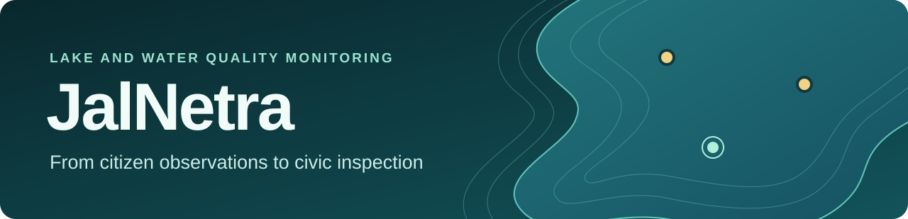
</p>

[Citizen lake map](https://jalnetra-wine.vercel.app/pilot.html?role=citizen) · [Community Drives](https://jalnetra-wine.vercel.app/community.html) · [Operator workspace](https://jalnetra-wine.vercel.app/pilot.html?role=operator) · [Public rehearsal](https://jalnetra-wine.vercel.app/?demo=1)

[Objectives](#objectives) · [Worked example](#worked-example-from-a-shoreline-photo-to-follow-up) · [Product features](#product-features) · [Community workflow](#community-workflow) · [Architecture](#system-architecture) · [Screenshots](#screenshots) · [Data and access](#data-and-access) · [Testing and setup](#testing-and-setup)

## The project

JalNetra is a community lake protection and restoration platform for Bengaluru. It connects shoreline observations, public precautions, organized cleanup drives, and operator follow-up across 21 mapped lakes.

A resident might notice foam, algae-like growth, waste dumping, or a suspected discharge near a lake. A photo captures the visible issue, while the shoreline sector and observation time give an operator context. JalNetra keeps those details together and uses recent observations to inform public advisories. The same platform lets local groups coordinate cleanups and gives operators a place to record what happened after a report.

## Objectives

| Objective | How JalNetra supports it |
| --- | --- |
| Make shoreline hazards easier to report | A citizen selects a lake and shoreline sector, adds a photo or written concern, and receives a report reference. |
| Give residents useful precautions | Lake conditions show available observations and category-specific advice, including when to avoid contact and seek operator review. |
| Help communities organize local action | Groups propose cleanups and lake adoption plans. Citizens can find approved drives and register to volunteer. |
| Keep corrective work traceable | Operators can link an action to a verified report, assign a team, record progress, and review a citizen's follow-up photo. |
| Measure completed work | The community dashboard derives its counts from recorded attendance, adoption status, and accepted restoration evidence. |

## Worked example from a shoreline photo to follow-up

**Public rehearsal · simulated foam observation at North Inlet**

| Step | What happens |
| --- | --- |
| First observation | The rehearsal starts with one eligible foam photo at North Inlet. The sector shows **Watch**. |
| Second observation | A citizen saves **Foam from a second view** in the same sector. The second distinct photo raises the rehearsal group to **Priority**. |
| Evidence handoff | The complaint draft lists both report IDs and timestamps so the recipient can trace the evidence behind the request for inspection. |

**Shared pilot · illustrative continuation**

For a similar report in the shared pilot, an assigned operator can confirm the visible concern, assign a team to investigate, and record the corrective work. A citizen can then submit a fresh photo from the same shoreline sector. Once an operator accepts that follow-up evidence, the lake dashboard counts one verified restoration. Field measurements are needed to assess whether water quality improved.

## Product features

| Workspace | Features |
| --- | --- |
| **Citizen homepage** | Bengaluru lake explorer, shoreline reporting entry points, and a section for approved drives scheduled on the current Bengaluru date. |
| **Citizen lake map** | Sector-level observations, precautions, lake following, personal stewardship checklists, and account-level in-app concern alerts. |
| **Community Drives** | Public cleanup schedule, volunteer registration, organizer email sign-in, and proposal status. Assigned operators can approve drives, manage attendance, and mark cleanups complete. |
| **Operator workspace** | Assigned-lake review queue, private evidence, image analysis, corrective work tracking, adoption approvals, and restoration verification. |
| **Public rehearsal** | An isolated, account-free scenario for submitting sample photos, observing hotspot changes, and downloading a complaint draft. |

## Community workflow

### Shoreline reporting and evidence review

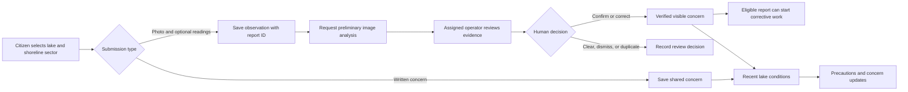

The browser normalizes submitted photos before upload. The report stores the lake, approximate shoreline sector, observation time, and optional readings or notes. Image analysis can surface cues such as foam or dumping and route unclear results to review. An operator can confirm, correct, clear, dismiss, or mark evidence as a duplicate. The advisory summarizes recent signals and presents precautions suited to the visible concern.

### Community cleanups and lake adoption

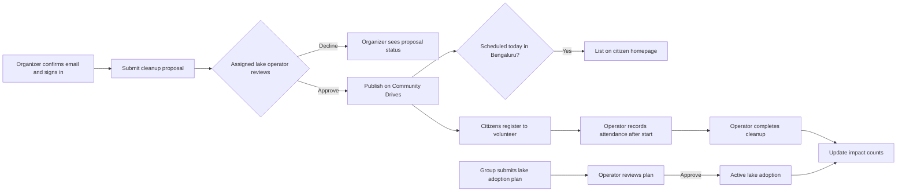

A cleanup proposal includes the organization, lake, start time in IST, meeting point, and safety instructions. Approval publishes it to the public schedule. The homepage uses the Bengaluru calendar date and displays the section when there is a scheduled drive for that day. Volunteer registration is available before the drive starts. Lake adoption is a separate application for ongoing stewardship, with its plan and approval state visible through the lake community board.

### Restoration and citizen verification

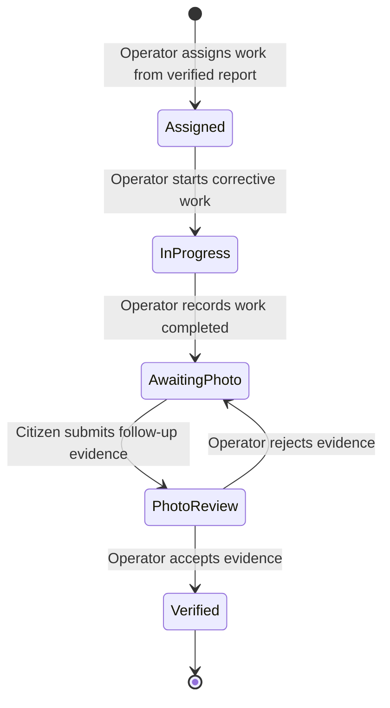

The tracker records the responsible team and work summary alongside the original incident. The follow-up must use a new photo from the same shoreline sector, uploaded after the work was recorded. Assigned operators can open the private photo and accept or reject it. An accepted submission adds one verified restoration to the lake's impact dashboard.

### Lake following and concern alerts

Citizens can follow lakes and save a personal stewardship checklist on the current device. A separate account-level lake subscription enables the in-app alert inbox. A new standalone concern or an operator confirmation or correction creates an alert for eligible subscribers. The inbox tracks which alerts have been read and refreshes while the citizen page is open.

## Evidence grouping and impact charts

### How evidence reaches Priority

| Eligible evidence in a 48-hour window | Rehearsal example | Evidence status |
| --- | --- | --- |
| 0 distinct photos | No image qualifies in the shoreline sector and category. | No active group |
| 1 distinct photo | One foam photo at North Inlet. | Watch |
| 2 distinct photos | A second eligible view of foam at North Inlet. | Priority hotspot |

```text
North Inlet rehearsal · eligible foam photos
Before adding the second view   █   1
After adding the second view    ██  2
```

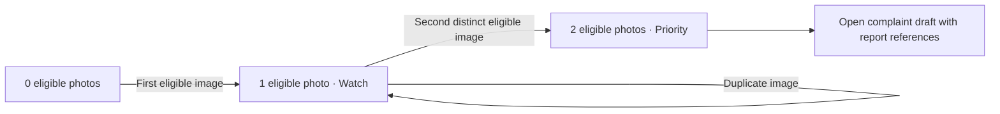

These are prototype thresholds. The rehearsal groups eligible photos by lake, sector, and category, with one count per normalized photo fingerprint. The shared pilot uses the latest human review and counts each eligible reporting citizen once in a group. The rehearsal complaint draft keeps the evidence references and can be reviewed, edited, and exported. Civic filing is a separate human action.

### What the dashboard counts

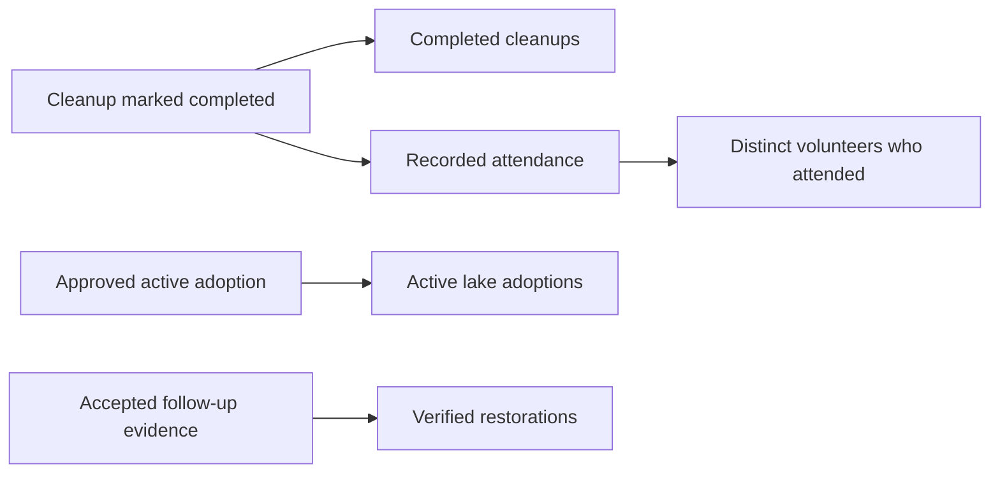

| Metric | Why it is counted |
| --- | --- |
| Completed cleanups | The lake operator marked the drive complete. |
| Volunteers who attended | A distinct volunteer has recorded attendance at a completed cleanup for the lake. |
| Active lake adoptions | The operator approved the stewardship plan and the adoption is still active. |
| Verified restorations | The operator accepted the follow-up evidence for the action. |

The impact dashboard uses stored records and can show zero activity. A photo and a completed work log establish the recorded follow-up. Water quality, pollution source, and ecological recovery require field measurements and verification.

## System architecture

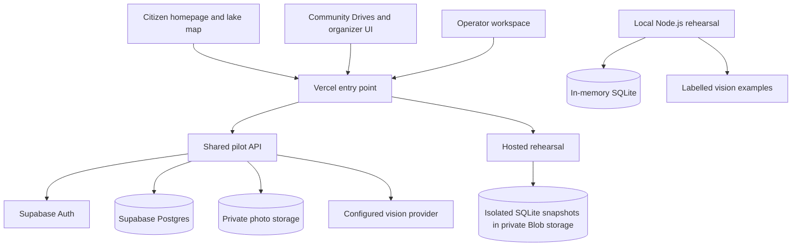

| Layer | Implementation |
| --- | --- |
| Browser | HTML, CSS, and JavaScript with lake maps, form workflows, and role-appropriate controls. |
| API | Node.js 24 with a Vercel entry point that routes shared pilot and rehearsal requests. |
| Shared persistence | Supabase Postgres for lake memberships, reports, review decisions, campaigns, attendance, adoptions, restoration actions, and alerts. |
| Evidence | Private Supabase photo storage for the pilot and SQLite-backed sample evidence for the rehearsal. |
| Image analysis | Server-side provider adapters with validated outputs and labelled sample responses for offline replay. |

## Screenshots

The screenshots show JalNetra's interface with isolated sample records.

### Citizen homepage

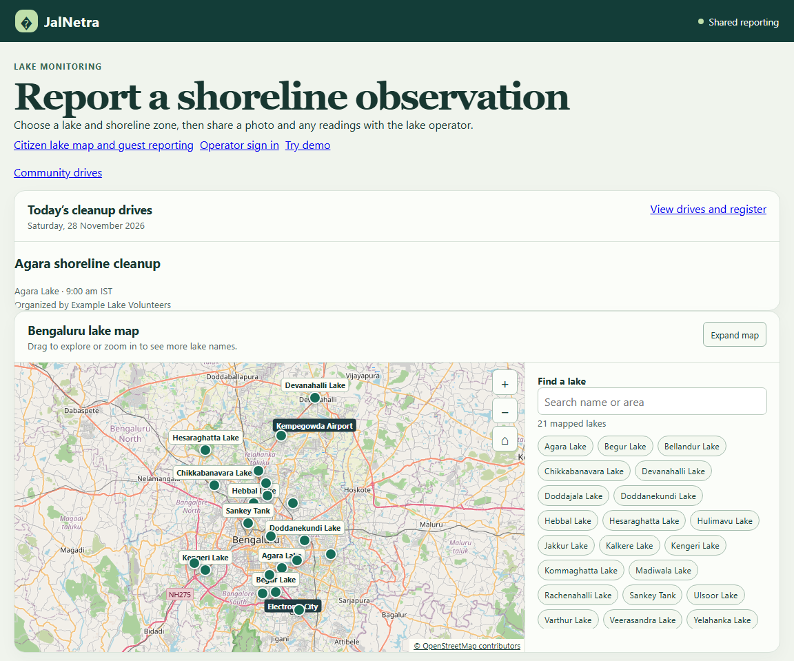

*The Bengaluru map shows the reporting lakes. The cleanup listing uses sample data. Map tiles © OpenStreetMap contributors.*

### Operator workspace

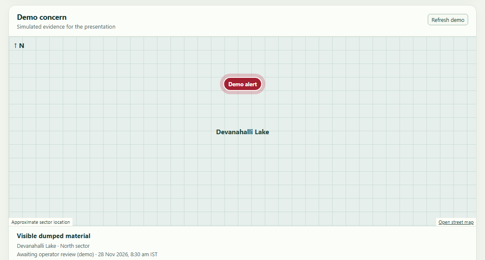

*The operator demo map marks the approximate shoreline sector of a simulated Devanahalli Lake concern.*

### Citizen lake advisory

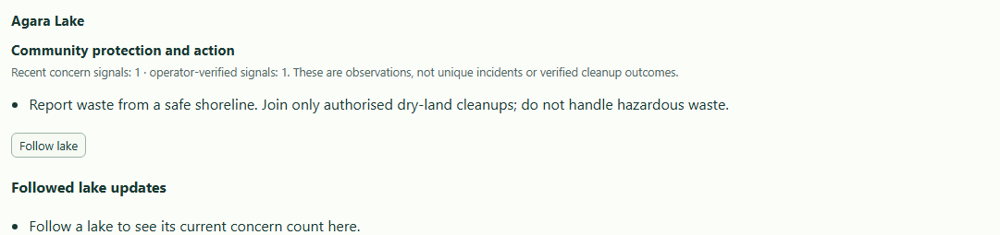

*Sample data. The advisory explains how to report waste safely and when to join an authorized cleanup.*

### Community Drives

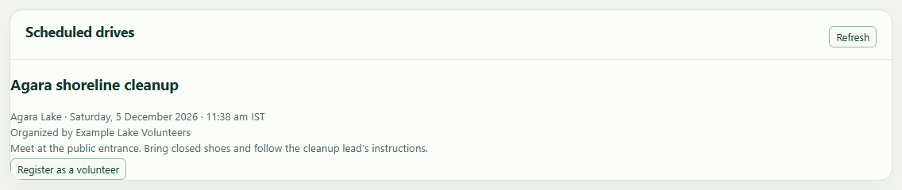

*Sample data. An approved drive card shows the organizer, time in IST, meeting instructions, and volunteer registration.*

### Restoration tracker

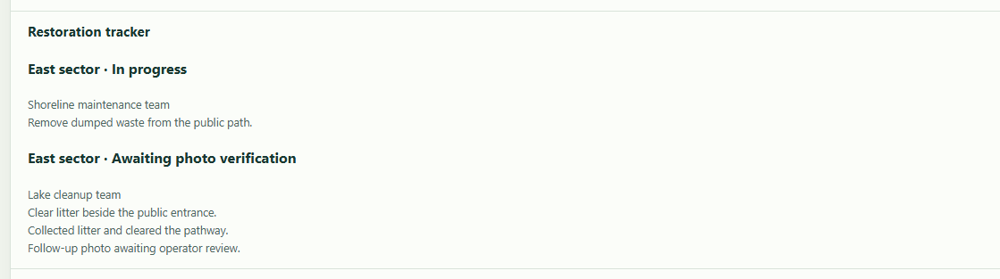

*Sample data. The tracker shows the assigned work and separates work in progress from follow-up evidence awaiting operator review.*

## Data and access

| Role | Access |
| --- | --- |
| Public visitor | Read the published cleanup schedule, aggregated lake conditions, and public impact counts. |
| Citizen | Submit reports, access their own evidence, register for cleanups, and submit follow-up verification photos. |
| Community organizer | Submit cleanup proposals and track their review status. A confirmed email is required to manage proposals. |
| Assigned operator | Access reports for assigned lakes, approve drives and adoption requests, record attendance, and review restoration evidence. |
| Lake administrator | Manage citizen and operator roles for assigned lakes. |

Database checks enforce lake membership and record ownership. The public schedule excludes proposals awaiting review. Evidence previews require authorized access, while the public conditions and impact views expose summaries.

<details>
<summary><strong>Shared record relationships</strong></summary>

A lake has shoreline sectors, memberships, reports, and cleanup campaigns. A campaign has volunteer registrations and attendance. A verified report can have one corrective action, and that action can have citizen follow-up evidence. Approved stewardship plans are recorded as lake adoptions. Lake subscriptions connect a citizen account to concern alerts independently of the device-local checklist.

</details>

## Testing and setup

Use Node.js 24 from the repository root.

```bash
node --test
node src/server.js --rehearsal
```

Open `http://127.0.0.1:3000` for the local rehearsal. It runs without provider credentials and uses an in-memory database. The shared pilot requires a migrated Supabase database, configured authentication, and Vercel environment settings. Public organizer email confirmation requires working SMTP.

| Check | Coverage |
| --- | --- |
| [Node tests](test/) and [GitHub Actions](https://github.com/BagaaBhai28/JalNetra/actions/workflows/tests.yml) | Report validation, evidence grouping, complaint generation, hosted rehearsal, API access, and provider response handling. |
| [Rollback-based database tests](supabase/tests/) | Lake access, cleanup publication and Bengaluru date boundaries, attendance, adoption, and restoration outcomes. |
| Production checks | Public pages and schedule routes were verified. A real organizer confirming email and taking one real drive through approval and attendance remains to be demonstrated together on production. |

<details>
<summary><strong>Public rehearsal steps</strong></summary>

1. Open the [public rehearsal](https://jalnetra-wine.vercel.app/?demo=1) or use the local server above.
2. Click **Start rehearsal**. North Inlet begins at **Watch**.
3. Save **Foam from a second view** at North Inlet and open the resulting **Priority hotspot**.
4. Download its complaint draft and compare the two supporting report IDs.
5. Submit **Obscured view** to see **Needs review**. **Restart rehearsal** resets the example.

</details>

## Repository map

| Path | Contents |
| --- | --- |
| [public/](public/) | Citizen homepage, maps, Community Drives, and operator workspace. |
| [src/](src/) | Photo processing, analysis, evidence grouping, shared pilot API, and rehearsal. |
| [api/jalnetra.js](api/jalnetra.js) | Vercel entry point. |
| [supabase/migrations/](supabase/migrations/) | Shared schema, lake roles, community workflows, and cleanup schedule. |
| [test/](test/) and [supabase/tests/](supabase/tests/) | Node integration tests and SQL workflow checks. |

[Deployment and access setup](docs/SUPABASE_PILOT.md) · [Technical architecture](docs/ARCHITECTURE.md) · [Demo instructions](docs/BUILD_AND_DEMO.md)
