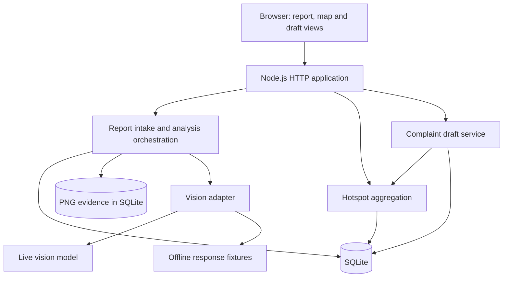
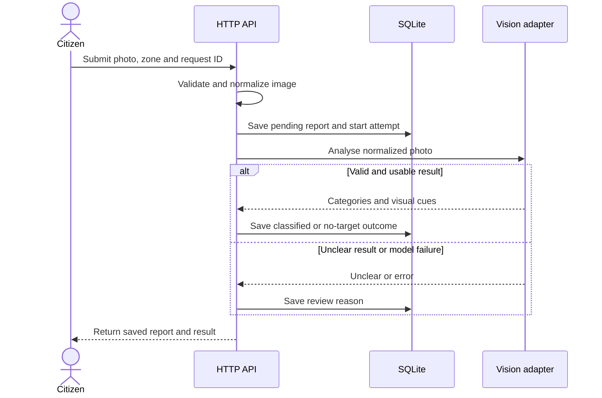
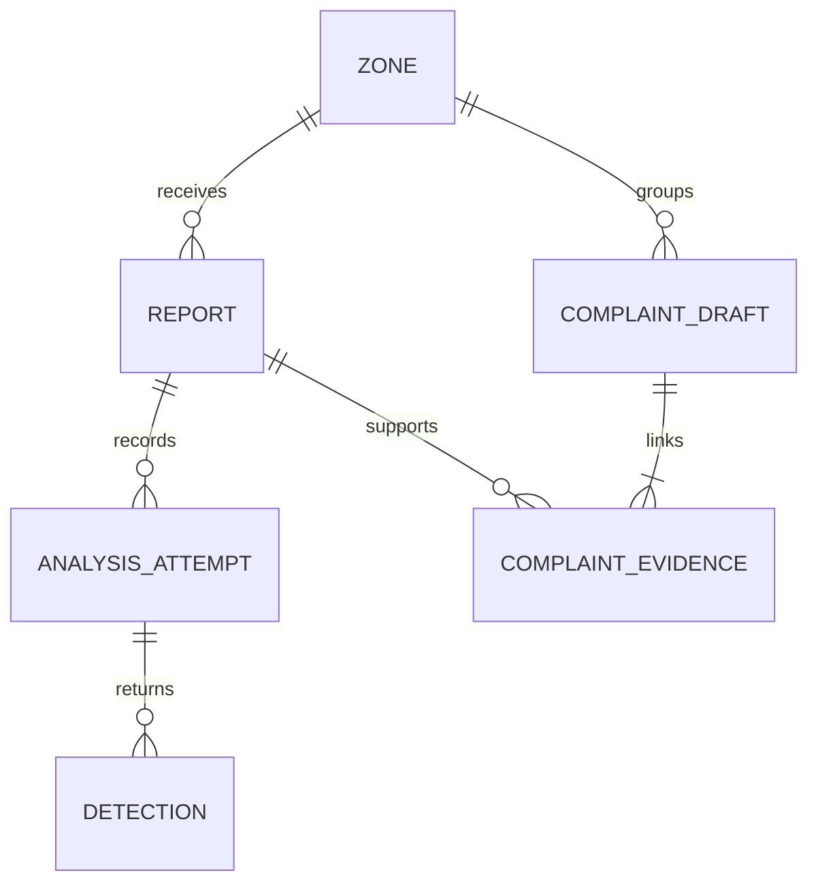

# System architecture

[Repository home](../README.md) · [Workflow](WORKFLOW.md) · [API contract](API.md) · [SQLite schema](../database/schema.sql)

## Shared deployment

The citizen pages, Community Drives and the operator workspace share the Vercel API entry point. Shared pilot requests use Supabase Auth, Postgres and private photo storage. The database checks lake membership and role before allowing operator actions. Public schedule and conditions responses expose only the fields intended for citizens. The community dashboard counts completed cleanups and verified restorations from shared records.

The Vercel rehearsal uses isolated browser sessions backed by private Blob storage. The local offline rehearsal uses in-memory SQLite. See [shared pilot setup and permissions](SUPABASE_PILOT.md).

## Local and rehearsal component diagram

| Component | Responsibility |
|---|---|
| Browser | Render the form, bundled map, status labels, evidence panel, history, and draft editor. |
| HTTP API | Serve the frontend and API from the same origin. Validate requests, identify the active data mode, and return consistent errors. |
| Intake | Validate format, byte limit and image dimensions. Strip metadata, save only the normalized image, and fingerprint it for evidence deduplication. |
| Vision adapter | Give live and replay modes one result contract. Validate labels and cues against the allowlist and time out the live request at about 12 seconds. |
| Hotspot service | Compute eligible evidence and group status from the persisted facts. The dashboard and complaint service share the same calculation. |
| Draft service | Recheck eligibility and save the draft with evidence report IDs in one transaction. |
| Persistence | SQLite stores zones, report and analysis history, and complaint drafts. Normalized PNG bytes are stored in SQLite and served by report ID. |

## Upload and analysis sequence

**Working on retries.** Uniquely constrain request IDs per data mode. Store report data and PNG bytes in one transaction and return the existing report for a repeat submission. Use a per-report attempt record with an expiry for model calls. Claim a retry atomically for one caller. A late response from an expired attempt must never replace the outcome of a fresher attempt.

## Data relationships

A report points to its current analysis attempt. Earlier attempts remain auditable. A draft records its selected evidence at generation time. Use that snapshot for later export even if a supporting report has aged out of the live dashboard.

## Runtime and data boundaries

| Concern | Prototype decision |
|---|---|
| Presentation | One local process on the presentation laptop. The map and fixtures ship with the build. Rehearsal uses a separate in-memory database. |
| Credentials | The vision key is supplied through an environment variable and stays on the server. |
| Model inputs | Send normalized pixels only. Keep citizen notes, readings and locations local during analysis. |
| Replay | Display the source and use demo-only data. Unknown replay images should return a clear unsupported-fixture outcome. |
| Citizen data | The prototype is a controlled demo. A pilot requires access controls, a retention policy, and verified complaint routing. |

## Suggested module order

Implement intake and storage first. Put vision adapters behind one interface so UI development can use fixtures. Next, make the map and complaint service call the same hotspot calculation. Add the demo reset after the end-to-end path works.
