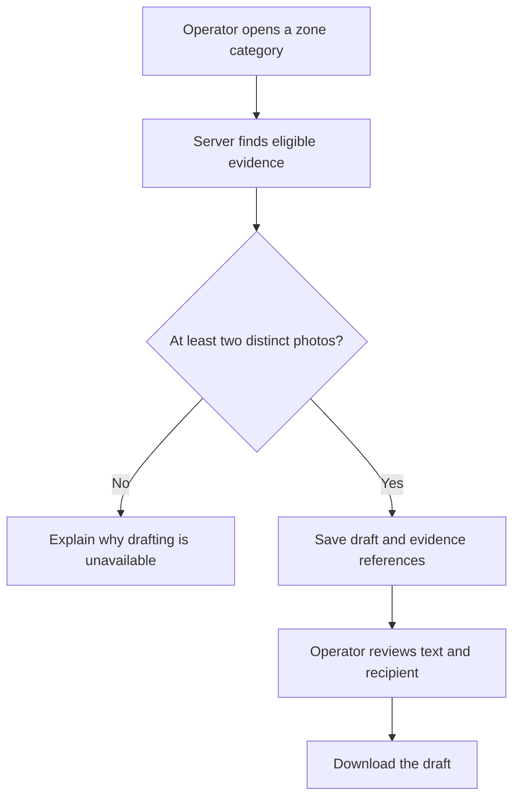

# Product workflow

[Repository home](../README.md) · [Architecture](ARCHITECTURE.md) · [Interface](INTERFACE.md)

## The problem

Lake observations often arrive as isolated photos or messages. To act on them, a civic operator needs a usable image, a location, a time, and a way to recognise related observations. JalNetra links those details in one report, groups current evidence, and prepares a draft that the operator can verify and export.

## How an observation is processed

This sequence describes the bundled rehearsal. For the live citizen, organizer and operator workflows, see the [evaluator walkthrough](BUILD_AND_DEMO.md).

1. Select **North Inlet**, **East Shore**, or **South Bank** on Demo Lake. Zone coordinates are approximate if a real pilot map is configured. The fictional map may omit them.
2. Submit a JPEG or PNG up to 5 MB. Record observation time separately from submission time. Store UTC and show IST to the demo audience. Optional pH and temperature are marked **Citizen-reported** and excluded from hotspot rules.
3. Decode and resize the photo in the browser. The server checks the pixel payload, encodes a PNG, and persists the report before analysis. Repeated submission of the same request ID and payload returns the existing report.
4. Ask the model for image quality and visible cues from the categories **foam**, **algae-like growth**, and **dumping**. A usable photo can return multiple categories or no target signs. Invalid responses and unclear photos enter **Needs review**.
5. Recompute active evidence on dashboard load and when drafting. For each data mode, lake, zone and category, count one accepted observation per normalized image fingerprint, using observation times from the previous 48 hours through the current time. Choose the most recent eligible observation as the representative for a duplicate fingerprint. Break equal-time ties by report ID to keep output stable.
6. Open the highest-priority marker for a zone and select a category. The detail panel lists its qualifying reports, times, thumbnails, and model cues. Older or unclear reports remain available in history.
7. Generate a draft when the category qualifies, then edit the recipient or wording and export. The operator verifies which civic body should receive a real complaint.

## Classification outcomes

| Situation | Display | Effect |
|---|---|---|
| Valid, usable image with a target sign | Classified | Consider each returned category independently. |
| Usable image with zero target signs | No target signs detected | Save in history. |
| Unclear photo, time limit, provider failure, or malformed response | Needs review | Save the reason and allow retry where applicable. |
| One unique eligible photo in a group | Watch | Show the category in zone details. |
| At least two unique eligible photos in a group | Priority hotspot | Enable complaint generation for the category. |
| Same normalized image in a group | Duplicate evidence | Save in history and count once. |
| Observation beyond the 48-hour window | Outside active window | Preserve the history and recalculate current status. |

## Complaint decision flow

Each draft includes the lake and zone, approximate location if available, observed category, count, evidence IDs and timestamps, and a request for inspection. It can include citizen-reported readings and attachment names. Keep the draft factual. For example, use “Two photos show visible foam near North Inlet” and ask for inspection of the area.

Two different images may depict the same scene. Pixel fingerprints catch repeated normalized files and provide a practical first-pass count. Field observations and a verified agency routing process belong in a pilot.
