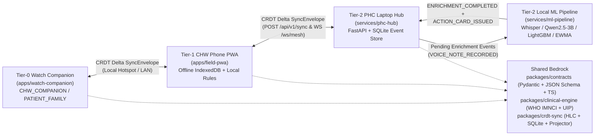

# Aarogya Mesh

**Autonomous, Offline-First, Capability-Proportional Edge Health Mesh** for Community Health Workers (CHWs / ASHAs) and dual-mode Patient-Family/CHW wearable companions.

Designed for disconnected rural primary healthcare — enabling deterministic clinical triage, peer-to-peer CRDT sync, and local edge AI across Tier-0 Watch, Tier-1 Phone, and Tier-2 PHC Clinic Hub.

---

## Core Architectural Invariants

1. **Autonomous Node Kernel (Zero RPC Coupling)**: Every node — Tier-0 Watch, Tier-1 CHW Phone, and Tier-2 PHC Laptop Hub — operates 100% standalone indefinitely without internet or peer connectivity.
2. **Capability-Proportional Execution**: Each node inspects its `HardwareCapabilityManifest` (`tier`, `ram_mb`, `cpu_cores`, `battery_pct`, `has_npu`, `installed_models`) and routes workloads deterministically (`LOCAL_DETERMINISTIC`, `LOCAL_TINY_ML`, or `DEFER_TO_HUB`).
3. **Clinical Safety Floor**: Deterministic WHO IMNCI & India UIP / ASHA clinical rules (`packages/clinical-engine`) are the immutable hard floor. Local SLMs never own raw triage or override danger-sign escalations.
4. **Opportunistic HLC / CRDT Delta Sync**: Nodes exchange immutable append-only `CrdtEvent` logs ordered by Hybrid Logical Clocks (`packages/crdt-sync`) over local Hotspot / LAN / WebSocket whenever peers come into range, converging with strong eventual consistency.
5. **Zero-Bloat Edge Footprint**: Pure Python 3.12 (`uv`), FastAPI, SQLite, and lightweight CPU/NPU INT8 runtimes — zero PyTorch or CUDA dependencies.

---

## Architecture Overview



See [ARCHITECTURE.md](./ARCHITECTURE.md) for the full mechanism-first specification and [docs/QUICKSTART_GUIDE.md](./docs/QUICKSTART_GUIDE.md) for quick start, phone sync, and presentation deck instructions.

---

## 4-Module Ownership Map

| Track | Module Path | Owner | Status |
| --- | --- | --- | --- |
| **Track 1: Core Bedrock** | `packages/contracts`, `packages/clinical-engine`, `packages/crdt-sync`, `services/phc-hub` | Core / `@Gauthampro7` | Complete & Verified |
| **Track 2: Field PWA** | `apps/field-pwa` | `@Akarshx-x` | Complete & Merged (`#2`–`#7`, `#15`–`#17`, `#26`, `#30`–`#33`, `#40`, `#41`) |
| **Track 3: Watch Companion** | `apps/watch-companion` | `@aril-travass` | Complete & Merged (`#18`–`#21`, `#34`, `#42`) |
| **Track 4: Local ML Pipeline** | `services/ml-pipeline` | `@Krishnanand-10` & Core (`@Gauthampro7`) | Complete & Merged (`#22`, `T4-07`) |
| **Track 5: Native Android APK** | `apps/android-app` | Core / `@Gauthampro7` | Complete & Verified (`T5-01`, signed APK `v0.1.0`) |


---

## 2-Minute Local Quickstart

**Prerequisites**: Python `3.12+` and [`uv`](https://docs.astral.sh/uv/) installed.

```bash
# 1. Clone & install workspace dependencies
git clone https://github.com/Gauthampro7/aarogya-mesh.git
cd aarogya-mesh
uv sync

# 2. Run the full test suite across all workspace packages
make test

# 3. Verify lint, contracts, schemas, and tests together
make verify

# 4. Boot the Tier-2 PHC Hub locally (http://127.0.0.1:8000)
make run-hub
```

Once the Hub is running, inspect:
- `GET http://127.0.0.1:8000/health` — Hub liveness check
- `GET http://127.0.0.1:8000/manifest` — Live host `HardwareCapabilityManifest`
- `GET http://127.0.0.1:8000/docs` — Interactive OpenAPI docs

---

## Interactive 3-Tier Walkthrough (`/showcase` on `:8000`)

Explore the complete **3-Tier Offline Mesh** (Watch + Phone + Hub Brain) live on a single port (`:8000`), along with the interactive offline presentation deck at `/deck/`:

1. **Boot the Unified Stage** (auto-builds `apps/field-pwa` and `apps/watch-companion` bundles if needed):
   ```bash
   make run-hub
   ```
   Open **`http://127.0.0.1:8000/showcase`** (3-Tier Live Interactive Stage) and **`http://127.0.0.1:8000/`** (PHC Command Center).
2. **Prove Airplane-Mode & Pure *Shuddh Tatsama* Hindi (`हिन्दी`)**:
   - Disconnect Wi-Fi / toggle Airplane Mode on the laptop; confirm zero CDN calls and instant local rendering.
   - Click the **`हिन्दी`** toggle on `/showcase` or `/` (and inside the embedded Watch `/watch/` and Phone `/phone/` frames) to show pure *Shuddh Tatsama* Hindi clinical UX.
3. **Interactive Live Watch + Phone -> Hub Sync**:
   - In the left **Tier-0 Watch** bezel (`/watch/`), switch between `CHW_COMPANION` and `PATIENT_FAMILY` modes and tap a danger sign (`RED_EMERGENCY` fires in 0ms locally).
   - In the middle **Tier-1 Phone** frame (`/phone/`), register a patient or run a WHO IMNCI checklist and tap **Sync** — watch the right-hand **Tier-2 PHC Hub Brain** light up live every 2s.
4. **1-Click Real-Data Scenarios (Real CRDT + Enrichment Pipeline)**:
   - **`maternal_sos`**: Watch SOS + Phone ANC visit -> deterministic `RED_EMERGENCY` safety floor + Action Card pushed back to Watch.
   - **`pediatric_voice_offload`**: Phone uploads `.webm` audio blob + `PENDING` voice note -> click **Run Hub Enrichment** -> drains queue, renders SHAP risk bars & `ACTION_CARD_ISSUED`.
   - **`village_outbreak`**: Multi-node spike across Rampur -> triggers EWMA `OUTBREAK_ALERT_RAISED` banner.
   - **`crdt_conflict_merge`**: Concurrent offline edits converge deterministically via HLC `(wall_ms, logical, node_id)` — click **Reset** between takes.

---

## Native Android APK (Phone + Watch Companion on Galaxy S23)

Build and install the standalone offline Android WebView shell (`com.aarogyamesh.app`, bundling `/phone/` + `/watch/` over `127.0.0.1` with native `RECORD_AUDIO`, `VIBRATE`, battery/network bridge, and LAN Hub sync):

```bash
# 1. Build & sign apps/android-app/dist/aarogya-mesh.apk
./apps/android-app/build_apk.sh

# 2. Install & launch on Samsung Galaxy S23 (pass your ADB serial)
adb -s "$ADB_SERIAL" install -r apps/android-app/dist/aarogya-mesh.apk
adb -s "$ADB_SERIAL" shell pm grant com.aarogyamesh.app android.permission.RECORD_AUDIO
adb -s "$ADB_SERIAL" shell am start -W -S -n com.aarogyamesh.app/.MainActivity
```

See [apps/android-app/README.md](./apps/android-app/README.md) for LAN PHC Hub sync details.

---

## Airplane-Mode Demo Script (3-Minute Verification)

Demonstrate full offline autonomy and opportunistic CRDT convergence without internet:

1. **Disconnect Network**: Enable Airplane Mode (or disconnect Wi-Fi) on the demo machine.
2. **Tier-0 / Tier-1 Standalone Triage**: Run deterministic IMNCI / danger-sign triage locally via `packages/clinical-engine` (or `POST /api/v1/triage`). Confirm `RED_EMERGENCY` triggers immediately on any single danger sign (`confidence = 1.0`, zero network required).
3. **Offline Divergence & Voice Note Queueing**: Simulate offline edits on Watch (`CHW_COMPANION` / `PATIENT_FAMILY`) and CHW Phone (`PATIENT_REGISTERED`, `TRIAGE_COMPLETED`, `VOICE_NOTE_RECORDED` with `enrichment_state = PENDING`).
4. **Opportunistic Peer Sync**: Reconnect over local Hotspot/LAN and send `SyncEnvelope` payloads to `POST /api/v1/sync`. Watch `packages/crdt-sync` merge events deterministically via HLC ordering `(wall_ms, logical, node_id)`.
5. **Deferred Tier-2 Enrichment & Sync Back**: Hub processes `GET /api/v1/enrichment/pending` via `services/ml-pipeline`, emits `ENRICHMENT_COMPLETED` + `ACTION_CARD_ISSUED`, and returns the delta `SyncEnvelope` so Watch and Phone converge to identical state (`pending_enrichments == 0`).

---

## Contributing

1. Read [ARCHITECTURE.md](./ARCHITECTURE.md) and [CONTRIBUTING.md](./CONTRIBUTING.md).
2. Branch from `origin/main` (`feat/<module>-<short-slug>`), respect module boundaries in [.github/CODEOWNERS](./.github/CODEOWNERS), and run `make verify` before opening a Pull Request.
